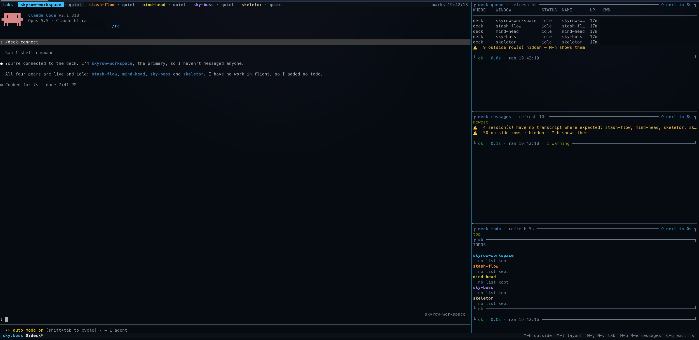
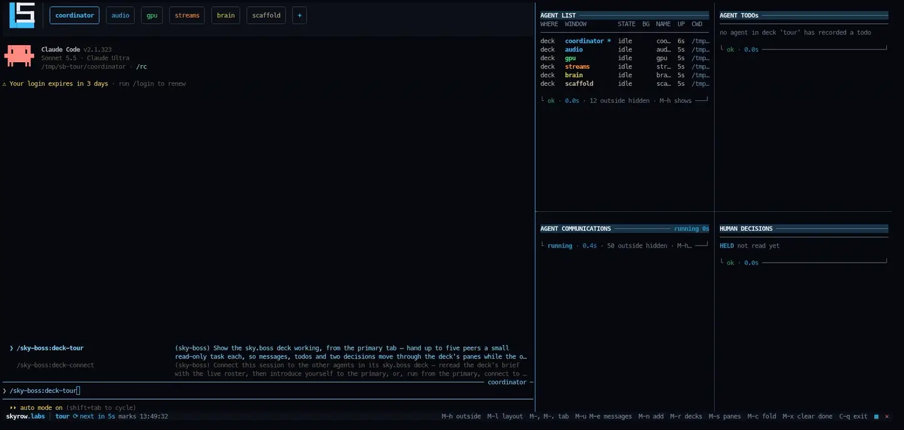
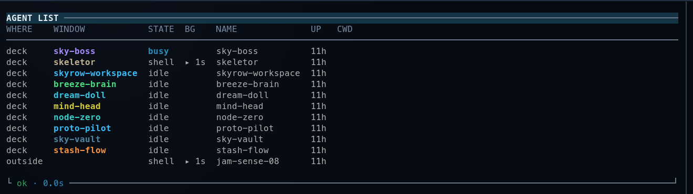
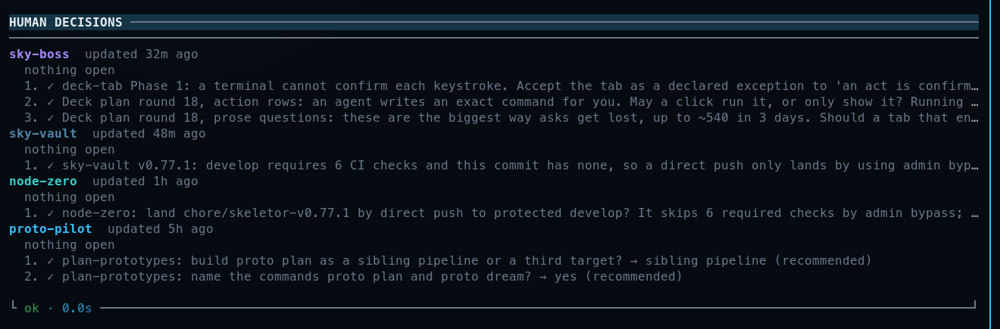
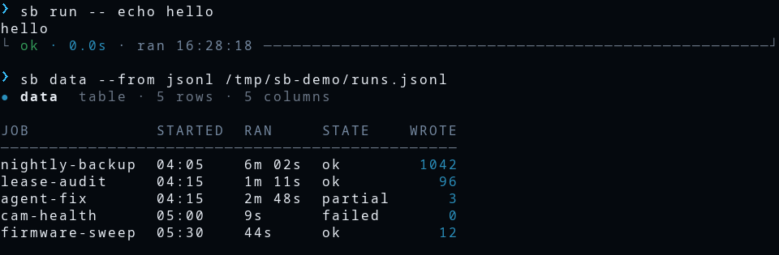
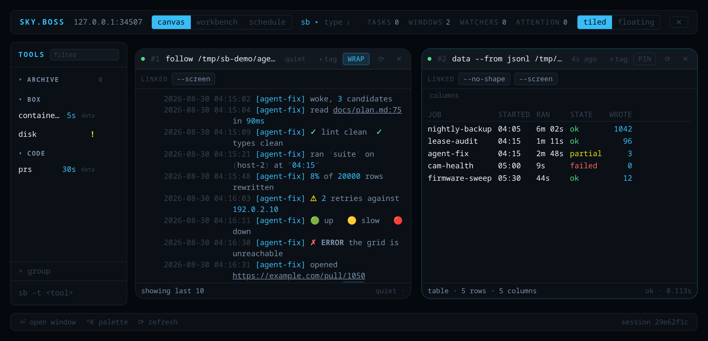

<p align="center">
  
</p>

<p align="center">
  <a href="https://github.com/skyrowlabs/sky-boss/actions/workflows/ci.yml"></a>
  <a href="https://github.com/skyrowlabs/sky-boss/releases"></a>
  <a href="https://github.com/skyrowlabs/sky-boss/actions/workflows/ci.yml"></a>
  <a href="LICENSE"></a>
  
</p>

<p align="center">
  <a href="#start-a-deck"><b>Start a deck</b></a> ·
  <a href="#inside-the-deck"><b>Inside the deck</b></a> ·
  <a href="#human-decisions"><b>Human decisions</b></a> ·
  <a href="#beyond-the-deck"><b>Beyond the deck</b></a> ·
  <a href="#the-commands"><b>Commands</b></a> ·
  <a href="#the-canvas"><b>The canvas</b></a>
</p>

**Run a Claude Code agent in every repo, and work them from one tmux window.** The sky.boss deck
gives each agent a tab and keeps four things in view beside them: which agents are working, what
they told each other, what each has left to do, and what they need from you.

<p align="center">
  <a href="docs/design/readme-deck.png"></a>
</p>

This is one real session, ten agents across ten repos, with the operator's directories and a few
private lines blanked out. Click it for full size.

<p align="center">
  
</p>

That is `/deck-tour`, run by three real agents in a sandbox: the planner hands out two tasks, the
todos and messages fill in, one decision is ruled with a click, and the answer comes back. Idle
stretches are sped up.

## Start a deck

You need Python 3.12+, tmux, and [Claude Code](https://claude.com/claude-code) on your `PATH`.

```bash
git clone https://github.com/skyrowlabs/sky-boss
cd sky-boss
python3 -m venv .venv && .venv/bin/pip install -r requirements.txt
ln -s "$PWD/sb" ~/.local/bin/sb          # or run ./sb from the repo
```

Declare your agents in `~/.sky-boss/deck.toml`. A profile is a set of tabs, primary first:

```toml
[agent.workspace]
cwd  = "~/src/workspace"
role = "coordinates the other repos"

[agent.api]
cwd  = "~/src/api"
role = "the public API"

[profile.core]
primary = "workspace"
tabs    = ["api"]
brief   = "Route cross-repo changes through workspace before committing."
```

Then open it:

```bash
sb deck --profile core
```

Each tab starts a live `claude` in that repo. The first time Claude Code sees a folder it asks
whether you trust it, and the tab reads `unregistered` until you answer.

- **Coming back:** `sb deck` with no profile reopens the saved tabs, each resuming its session.
  `--fresh` starts them over.
- **Leaving:** Ctrl-Q, or the ✕ in the corner, asks first, then saves and ends the deck and every
  agent in it. `sb deck exit` does the same without asking.
- **No config yet?** `sb deck` alone opens a deck with a shell tab, and the `+` in the tab row opens
  more. `roots = ["~/src"]` in `deck.toml` offers every folder under it.

An agent that is a project in `projects.toml` with a `cwd` needs no `[agent]` entry unless it wants
a `role`. `args` passes flags to its `claude`, and your own `-n` or `--append-system-prompt` wins
over the deck's.

## Inside the deck

**Each agent is a tab,** in its repo's colour, whose ground lights while the agent works and warns
when it needs you. Beside the tabs sit the panes. Choose which show with Alt-s, and fold one with
Alt-c:

| Pane | Shows | A click |
|---|---|---|
| **AGENT LIST** | Every session and its state: `needs you`, `busy`, `shell`, `idle` | Unfolds what it has running beside it |
| **HUMAN DECISIONS** | Everything the agents need from you | Rules on it |
| **AGENT TODOs** | Each agent's own list, grouped by agent | |
| **AGENT COMMUNICATIONS** | What the agents told each other | Opens the message whole |

<p align="center">
  
</p>

**The keys are listed in the bar.** They live in a key table only the deck's sessions use, so your
own tmux bindings are untouched:

| Key | Does |
|---|---|
| Alt-, and Alt-. | Previous and next tab |
| Alt-n | A new agent or terminal tab |
| Alt-l | Switches between the `columns`, `stack` and `grid` layouts |
| Alt-h | Shows or hides sessions outside the deck |
| Alt-s, Alt-c | Chooses the panes, folds the focused one |
| Alt-u, Alt-e | Scrolls messages back, returns to the newest |
| Alt-x | Clears every done todo and decided item |
| Ctrl-Q | Asks, then ends the deck |

Panes drag to resize. In the `grid` layout, click a title bar and then a pane in another column to
move it. Ctrl-C is never bound: it belongs to the agent.

## Human decisions

**Every ask of you lands in one queue.** Agents add rows instead of leaving a question in a report,
and you rule by clicking. The ruling is typed into the agent's tab, so the work carries on without
you going to find it.

<p align="center">
  
</p>

| An agent runs | You see |
|---|---|
| `sb deck decide add "<question>" --option "<choice>"` | The choices, on a click |
| `sb deck decide add "<what>" --run "<command>" --until <test>` | The exact command and folder. A click asks once, then runs it in a popup |
| `sb deck decide add "<what>" --action` | Something only you can do, with no command |
| `sb deck decide note "<text>"` | Something worth knowing, dismissed by a click |

- **An action closes on what is observed.** `--until` takes `pr:<n>`, `pushed:<sha>` or
  `gone:<branch>`. Pin a merge with `pr:<n>@<sha>`, so a row reads stale if the head moves.
- **A blocked tab raises its own row** saying what it is waiting on, and a turn that ends on a
  question marks the tab and adds a low row.
- **HELD, at the foot,** counts unpushed commits, green unmerged pull requests and open alerts
  across the deck's repos. Click to unfold it.

## Agents know they are in a deck

Each tab's `claude` is started with `-n <tab name>`, so the name you see is the name its peers
message. A short brief is appended to its system prompt: the deck it is in, every agent at launch
with its directory and role, and how to reach them and you. `sb deck brief` rebuilds it with the
deck as it stands now.

**`/deck-connect` brings an agent in on your word.** Type it in any tab: the agent reads its brief
afresh, checks who is live, and introduces itself to the primary; run in the primary, it connects to
every live tab instead. It ships in [`plugin/`](plugin),
a Claude Code plugin every tab loads with `--plugin-dir`, so nothing is installed into your Claude
Code configuration.

**`/deck-tour` shows the panes move.** Type it in the primary: it hands two live peers one small
read-only task each, one of which asks you a question in HUMAN DECISIONS. It runs only `git` reads
and `sb deck`, so it is safe beside real work. The clip above is
[`docs/design/render-deck-tour.mjs`](docs/design/render-deck-tour.mjs) recording it.

**An agent keeps its own todo list** with `sb deck todo add "<text>"` and `sb deck todo done <n>`.
A list belongs to the tab whose pane runs the command, found by process rather than by name, so a
session outside the deck cannot write a tab's list even if it shares the name.

<details>
<summary><strong>Every deck subcommand</strong></summary>

| Command | | Does |
|---|---|---|
| `sb deck` | **acts** | Creates or attaches the deck; `--profile NAME` opens a declared set of tabs |
| `sb deck open <name>` | **acts** | A tab for one agent, or that tab if it is open |
| `sb deck add <name>` | **acts** | A new agent tab, for this deck or kept in its profile |
| `sb deck terminal` | **acts** | A tab running your shell rather than `claude` |
| `sb deck jump <name>` | **acts** | Focuses an agent's tab |
| `sb deck layout columns\|stack\|grid` | **acts** | Moves the panes between layouts; nothing is killed |
| `sb deck column fold\|pick\|move` | **acts** | Folds, chooses and moves the panes |
| `sb deck reload` | **acts** | Re-applies the deck's settings and restarts its panes on this sky.boss's code |
| `sb deck save` | **acts** | Saves each open tab's session, so a later `sb deck` resumes it |
| `sb deck exit` | **acts** | Saves the tabs, then ends the deck and every agent in it |
| `sb deck todo add\|done\|rm\|clear` | **acts** | Edits a todo list |
| `sb deck decide add\|note\|done\|rm\|clear` | **acts** | Edits a list of decisions |
| `sb deck decide rule` | **acts** | Rules on a decision; for you, never an agent |
| `sb deck queue` | reads | Every agent session and its status, the deck's first |
| `sb deck messages`, `sb deck message` | reads | What agents told each other, newest last, and one message whole |
| `sb deck todo list`, `sb deck decide list` | reads | The lists, grouped by agent |
| `sb deck brief [name]` | reads | An agent's brief, rebuilt with the live roster |
| `sb deck places` | reads | Where a new tab can start |

</details>

## Beyond the deck

sky.boss began as one CLI for watching what other tools do, and the deck is built on it. It is worth
having on its own. Four ideas hold it together:

- **Every command says whether it acts.** `sb run` acts; `read`, `data` and `follow` observe. That
  line is load-bearing: a window may re-run a read on a cadence, because re-running a read is a
  refresh and re-running a write is a scheduler nobody asked for.
- **Commands return data; they never print.** One envelope — `ok` / `partial` / `data` / `warnings`
  — rendered by whoever is consuming it. `--json` on any command gives you the envelope itself.
- **sky.boss never parses human output.** `sb data` takes JSON. `sb read` shows what a command
  printed, verbatim, and says that is what it is doing. There is no `--pretty` that guesses.
- **sky.boss is never in the credential path.** External CLIs keep their own authentication.

In a terminal, every command draws the same envelope — the band under a `run`, and a file of
records shaped into a table:

<p align="center">
  
</p>

[The canvas](#the-canvas) is the other surface on top of that: a window of commands for watching.

The mark, this terminal session and the canvas are *rendered*, never drawn by hand:
`docs/design/render-mark.py` writes the mark from `ART` in `skyboss/banner.py` and captures the
terminal through a pty, and `docs/design/render-canvas.mjs` drives a real `sb ui` over the DevTools
protocol. Re-run them after changing anything they show. The deck's pictures are screenshots of a
live deck, with the operator's directories and private lines blanked out.

## The commands

| Command | | Does |
|---|---|---|
| `sb run -- <argv>` | **acts** | Runs a command and reports what it printed |
| `sb read -- <argv>` | reads | Shows what a command printed, verbatim |
| `sb data -- <argv>` | reads | Reads another CLI's JSON as data, and shapes it into a table |
| `sb follow -- <argv>` | reads | Holds a command's stream open. Any exit is a visible death |
| `sb follow <path>` | reads | Follows a file with a native stat cursor |
| `sb roll-call` | reads | Asks every declared project how it is, and folds the answers |
| `sb schedule` | reads | What fires next, across every project that declares a schedule |
| `sb agents` | reads | Which agent sessions are running right now, across every provider |
| `sb deck` | **acts** | A tmux controller: a tab per agent, each a live `claude` marked as working or needing you, beside panes for who is waiting on you and what agents told each other. `--profile` opens a declared set of tabs, each agent in its own colour; shortcuts are listed in the bar, and Ctrl-Q asks before ending everything — `open`, `jump`, `layout`, `marks`, `save`, `exit` and `todo add`/`done`/`rm` act; `queue`, `messages`, `brief` and `todo list` read. See [the deck](#start-a-deck) |
| `sb history <project>` | reads | A project's own run ledger, newest first |
| `sb job` | both | Jobs sky.boss issues — `list` reads; `run`, `install` and `uninstall` act |
| `sb tools` | reads | The commands you saved |
| `sb ui` | — | Opens [the canvas](#the-canvas) — a canvas of windows, and a workbench for authoring a command |
| `sb mcp` | — | Speaks MCP on stdio, offering your saved commands to an agent |

`--` separates sky.boss's flags from the command's own.

## Running something

```console
$ sb run -- echo hello
hello
└ ok · 0.1s · ran 20:03:29 ────────────────────────────────────────────┘
```

The band is on stderr, so `sb run -- x | grep y` still sees exactly what `x` printed.

```console
$ sb read -- printf 'alpha\nbeta\n'
alpha
beta
└ ok · 0.1s · ran 20:03:29 ────────────────────────────────────────────┘
```

<details>
<summary><strong>When a tool says less than it does in your terminal</strong></summary>

Every command sky.boss runs gets a pipe, not a terminal. Most tools only *lay out* differently for
one — sky.boss passes the real width so they do not — but some decide **what to print at all** by
asking `isatty()`, and those go quiet. Nothing is late or dropped; the tool never said it. That is
the one failure here with no symptom, because a window missing half its output looks exactly like
a job quietly working.

sky.boss will not guess which variable turns it back on, and keeps no table of tools that need one.
You say it:

```console
$ sb run --env GREETING=hello -- sh -c 'echo $GREETING'
hello
```

Repeatable, on `run`, `read`, `follow` and `data`, and applied last — over sky.boss's own
`COLUMNS` and `PYTHONUNBUFFERED`, because a declaration about *this* child beats a default about
every child. It rides into a saved command in the argv, exactly as `--cwd` does.

**Not for secrets.** The value is written verbatim into `tools.toml` and drawn in a window title.
Anything private is already inherited from your own environment — sky.boss is never in the
credential path.

</details>

<details>
<summary><strong>Running something later</strong></summary>

```bash
sb run --delay 5m -- ./deploy.sh
```

A countdown you can watch and cancel. `q`, `Esc` or Ctrl-C cancels and nothing ran; so does closing
the terminal. There is no queue, no state file and no unit written — **a command that must outlive
the window wants systemd.** Cancelling exits non-zero, so a script can tell the difference.

</details>

## Reading another tool as data

`sb data` parses a tool's JSON and decides how to draw it — which columns are worth showing, which
are prose that belongs on its own line, which are opaque identifiers nobody scans.

```console
$ sb data -- printf '[{"host":"web-1","state":"up","region":"iad"},{"host":"web-2","state":"down","region":"sfo"}]'
● data  table · 2 rows · 3 columns

HOST   STATE  REGION
────────────────────
web-1  up     iad
web-2  down   sfo
```

`table · 2 rows · 3 columns` is the header saying what arrived. Pick columns yourself with
`--cols`:

```console
$ sb data --cols host,state -- printf '[{"host":"web-1","state":"up","region":"iad"},{"host":"web-2","state":"down","region":"sfo"}]'
● data  table · 2 rows · 3 columns

HOST   STATE
────────────
web-1  up
web-2  down
```

<details>
<summary><strong>Rows inside a mapping</strong></summary>

Real tools wrap their rows in a mapping, because a bare array has nowhere to put a timestamp.
`--rows` says where they are; without it sky.boss infers only when exactly one value is a list of
rows, and reports rather than guesses when two are.

```console
$ sb data --rows hosts --cols host,state -- printf '{"generated":"2026-08-23T20:00:00Z","hosts":[{"host":"web-1","state":"up"},{"host":"web-2","state":"down"}]}'
● data  object · 2 keys

  generated   2026-08-23T20:00:00Z
hosts  table · 2 rows · 2 columns
  HOST   STATE
  ────────────
  web-1  up
  web-2  down
```

</details>

<details>
<summary><strong>Nothing is silently wrong</strong></summary>

A column you named that no row carries is drawn — "nothing matched" is often the answer — **and
reported**:

```console
$ sb data --cols host,nope -- printf '[{"host":"a"}]'
● data  table · 1 row · 1 column

HOST  NOPE
──────────
a     -
⚠️  no row has this field: nope — drawn empty, in case that is the answer
```

A tool that fails carries its reason, never its output — a failed tool is one whose output should
not be believed:

```console
$ sb data -- sh -c 'echo "boom: no credentials" >&2; exit 3'
✗ data failed
● data  object · 4 keys

  command      sh -c 'echo "boom: no credentials" >&2; exit 3'
  exit_code    3
  duration_s   0.0
  error        boom: no credentials
```

</details>

<details>
<summary><strong>The envelope, and <code>--refresh</code> as a stream</strong></summary>

`--json` is a root flag, so it works on every command:

```console
$ sb --json data -- printf '[{"host":"a"}]'
{
  "command": "data",
  "ok": true,
  "partial": false,
  "data": [
    {
      "host": "a"
    }
  ],
  "warnings": [],
  "view": {
    "columns": [
      {
        "key": "host",
        "label": "HOST",
        "flex": 1,
        "min": 4,
        "max": 4
      }
    ],
    "details": [],
    "hidden": []
  }
}
```

**`view` describes how to present `data`; it never filters it.** Every field the tool returned is
still there, so `| jq` keeps what the table chose to hide.

**`data --refresh` off a terminal is a stream of those envelopes**, one NDJSON line per tick, rather
than the live redraw you get in a shell. `--json` takes the same path. Each line is exactly the
envelope above plus `tick` and `at`, so anything that reads one already reads these:

```console
$ sb data --refresh 1 -- printf '[{"host":"a"}]' | head -2 | jq -c '[.tick, (.data|length)]'
[1,1]
[2,1]
```

`at` is ISO 8601 with an offset — a stream needs an unambiguous instant, not a wall clock. **Warnings
ride the line and are not repeated on stderr**, which a one-shot does: nothing is lost, since
`warnings` is a field on every line, but a consumer watching stderr will see silence where a single
read would have spoken. The stream ends when you leave, or when whatever is reading it does —
`| head -3` gives three lines and exits clean. `sb read --refresh` still needs a terminal: verbatim
text has no envelope worth streaming.

</details>

Exit codes: `0` ok, `1` hard failure, `3` partial — not 2, which Click uses for usage errors.

## Following something

Resident by nature. Arrows, PgUp/PgDn and Home scroll back through the ring; `End` returns to
following; `q`, `Esc` or Ctrl-C leaves.

```bash
sb follow -- journalctl -f                    # a stream; any exit is a visible death
sb follow /var/log/nginx/access.log           # a file, by stat cursor
sb follow --due 15m /var/log/cron.log         # past 15m of silence, the band says late
```

<details>
<summary><strong>The band, and what <code>--due</code> watches</strong></summary>

The band is the scrollbar:

```
┌ /var/log/cron.log · follow ────────────── quiet 3m of 15m · last write 15:23 ┐
└ 246.4 KiB · showing 41–60 of 200 · parked ───────────────────────────────────┘
```

`--due` is the cron watcher, and it never learned what cron is: a schedule is a declaration, a run
is evidence, and the evidence is the log. You assert an interval; sky.boss subtracts.

</details>

## Saving a command

`--save NAME` on `read`, `data` or `follow` saves the invocation and then runs it. It appends to
`~/.sky-boss/tools.toml` and refuses a name that exists, because `--save` saves *by example* — and
`run` does not take it at all, since there is no example for a write you have not run.

```bash
sb data --cols number,title --refresh 30 --save prs -- gh pr list --json number,title
sb tools prs        # or the short spelling: sb -t prs
```

`sb tools` lists what you saved, and what failed to load. A fresh clone has saved nothing and says
so rather than raising:

```console
$ sb tools
● tools  object · 3 keys

  tools        -
  formats      -
  highlights   -
```

<details>
<summary><strong>The workbench writes, groups, and the rail</strong></summary>

**The workbench writes too**, and it is the way to create an act, to edit one, or to delete one.
Its save button writes the block directly rather than re-running your command, so it works for
every contract; a name that already exists is replaced rather than refused, and the tools rail
carries ✎ and ✕ per row. Every write copies `tools.toml` into `~/.sky-boss/backups/` first, and
only ever rewrites the one block it is changing — the rest of the file, your comments included, is
untouched byte for byte.

A saved command inherits `acts` from the first word of its argv, so one wrapping `run` is refused a
cadence exactly as `sb run` is — the read/write line survives being given a name.

**A tool may declare a group**, and the rail draws it as a folded-away section rather than one long
alphabetical list:

```toml
[tool.prs]
group = "code"
argv  = ["data", "--", "gh", "pr", "list", "--json", "number,title"]
```

It is a *label*, never an address — `sb tools prs` is unchanged, there is no group you can invoke,
and names stay unique across every group. Groups sort alphabetically with the ungrouped last, in
`sb tools` and in the rail alike. Nothing is guessed from the name: a tool called `disk-free` is
ungrouped until you say otherwise. Which groups you have folded is remembered between launches, in
`~/.local/state/sb/` with the rest of the surface's own state.

**A group exists if any command names it, or if it is declared** — neither implies the other. A
declaration is how an *empty* group exists:

```toml
[group.archive]
description = "old things"
```

The rail can make one (`+ group`), delete one **while it holds nothing**, and move a command between
groups by dragging its row. A delete is refused while any command is still in the group, and the
refusal names them; it never deletes a command. A drag changes the one `group` line inside that
command's block, so nothing else in it — including a comment you wrote inside it — is touched, and
the file is backed up first like every other write.

</details>

## Many projects at once

**sky.boss federates; it never owns.** Declare what each project publishes in
`~/.sky-boss/projects.toml` — a command to ask, or a file to read — and each project stays the
authority on itself. One project down is `partial`, never blank.

```bash
sb roll-call
sb roll-call --only api
```

With nothing declared it says so rather than pretending:

```console
$ SB_HOME=/tmp/empty-sb sb roll-call
● roll-call  object · 0 keys

⚠️  no projects declared — see /tmp/empty-sb/projects.toml
```

<details>
<summary><strong><code>projects.toml</code>, and what <code>partial</code> looks like</strong></summary>

```toml
[project.api]
argv = ["api-ctl", "status", "--json"]
cwd  = "~/src/api"
rows = "jobs"
cols = "job,result,last_age"

[project.sensors]
path = "~/src/sensors/tmp/status.json"
```

No ledger, no history, no cache — which is what lets sky.boss stay stateless. A copy of a schedule
that agents rewrite goes stale without announcing it; unreachability is visible, staleness is not.

```
api
  jobs  table · 29 rows · 15 columns
    JOB           RESULT   LAST_AGE
    ───────────────────────────────
    sentinel      red      11h ago
    integration   ok       11h ago

sensors
    error    No such file or directory
    source   ~/src/sensors/tmp/status.json

⚠️  sensors: No such file or directory
```

</details>

## The canvas

```bash
sb ui
```

A followed log holding open on the left, tinted by *shape* rather than by anyone's severity
vocabulary, the same records shaped into a table on the right, and the commands you saved down the
side:

<p align="center">
  
</p>

Two screens. **The canvas** is a command
palette over tiled and floating windows: every command opens a window, and a pinned window re-runs
itself on a cadence. **Nothing keeps a command table** — the palette walks the real Click tree, so
it cannot offer a command that does not exist.

**The workbench** is where a command gets made rather than invoked. Assert the contract — `run`
acts, `data`, `read` and `follow` observe — type the argv, and *trial run* it: the result is drawn
through the same renderer a window uses. An **act has no trial run**, and the server refuses one
rather than the page merely not offering it.

<details>
<summary><strong>Why the refresh clock lives in Python, and how to develop against it</strong></summary>

The refresh clock lives in Python, keyed to the connection: a browser timer in a hidden tab is
clamped to roughly one fire a minute, so a 5s watcher would silently become a 60s one at the exact
moment you stopped being able to see that it had.

Nothing is selected when the bench opens, because the contract is the one bit no parser can infer
and choosing it for you would be that inference with a friendlier face. `--cols` is the flag the
bench exists for: one you get wrong by typing and right by looking.

```bash
sb ui --no-browser --port 8765     # develop against it in a browser
```

</details>

## Offering it to an agent

```bash
sb mcp
```

Speaks MCP on stdin/stdout — no port, no token, no daemon. Register it with any MCP client:

```json
{"mcpServers": {"sky-boss": {"type": "stdio", "command": "sb", "args": ["mcp"]}}}
```

```console
$ printf '%s\n' '{"jsonrpc":"2.0","id":1,"method":"initialize","params":{}}' '{"jsonrpc":"2.0","id":2,"method":"tools/list"}' | sb mcp
```

> [!IMPORTANT]
> **An agent reaches the commands you saved, and nothing else.** Every exposed tool has an *empty
> input schema* — there is no string an agent can put anywhere. Excluded by rule, not by list:
> anything that acts, anything resident, and anything taking a free-form argv.

That last one is the whole safety argument. Choosing `data` over `run` is *your* assertion that
something is a read; an assertion an agent makes about its own argv is not a safety property, it is
a shell with a reassuring name.

## Configuration

| What | Where |
|---|---|
| Saved commands | `~/.sky-boss/tools.toml` |
| Capture formats and highlight rules | `~/.sky-boss/formats.toml` |
| Declared projects | `~/.sky-boss/projects.toml` |
| Deck agents | `~/.sky-boss/deck.toml` |
| Canvas browser profile, deck todo lists | `~/.local/state/sb/` |

`$SB_HOME` and `$SB_STATE` override the first four and the last. An absent file degrades to
nothing declared rather than raising.

## Development

```bash
.venv/bin/python -m pytest              # the whole suite, no network
.venv/bin/python -m pytest -k readme    # the examples in this file
```

Every `$ sb …` example above — including the ones folded away — is executed by
`tests/test_readme.py`, so a README that shows a command which no longer works fails the build. CI
runs that same suite on every push and pull request.

`docs/design/fundamentals.md` is the constitution; `docs/implementations/` holds one doc per
feature that shipped, indexed at `docs/implementations/README.md`, and `docs/TODO/` is the same
thing, still open.

## License

[MIT](LICENSE) © SKYROW LABS LLC
